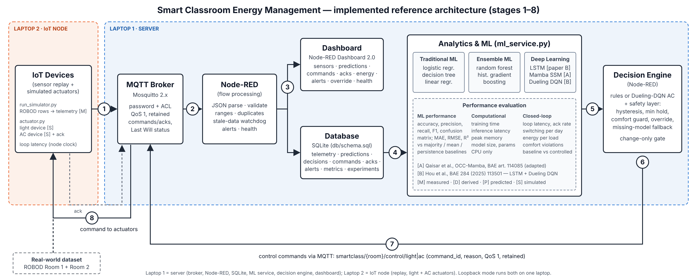

# Smart Classroom Energy Management — Team 1

Occupancy-driven lighting and air-conditioning control using IoT (MQTT, Node-RED, SQLite, Node-RED Dashboard) and
machine learning, on the ROBOD lecture-room dataset.

**Amrita School of Computing, Amrita Vishwa Vidyapeetham, Amritapuri · B.Tech CSE · Internet of Things project ·
2026–2027**

**Guide:** Dr. Sangeeth Kumar, Associate Professor, Center for Wireless Networks & Applications (Amrita WNA)

| Member | Roll number | Subsystem |
|---|---|---|
| Niranjan N S | AM.SC.U4CSE23338 | Decision engine, Dueling DQN, energy and comfort evaluation (shared) |
| Sivadev Smijith | AM.SC.U4CSE23359 | Decision engine, Dueling DQN, energy and comfort evaluation (shared); Node-RED, SQLite, dashboard |
| Yalamarthi Jyothi Sri Krishna Chaitanya | AM.SC.U4CSE23370 | IoT node, MQTT broker, security, two-laptop deployment |
| Penumallu Ram Dinesh Reddy | AM.SC.U4CSE23341 | Dataset, features, traditional and ensemble ML, evaluation |
| Manish Shishirchandra Dora Aluri | AM.SC.U4CSE23333 | LSTM and Mamba models, ML service |

**Deliverables:**
- [Final report (PDF)](deliverables/REPORT/Smart_Classroom_Final_Report.pdf) and its LaTeX source
  (`deliverables/REPORT/latex_source/`)
- [Presentation](deliverables/PRESENTATION/Smart_Classroom_Energy_Management_Final_Presentation.pptx)
- [Test summary](deliverables/TEST_RESULTS/TEST_SUMMARY.md)
- [Acceptance matrix](deliverables/DOCUMENTATION/FINAL_ACCEPTANCE_MATRIX.md)
- [Two-laptop deployment guide](docs/TWO_LAPTOP_DEPLOYMENT_GUIDE.md)
- Evidence: `deliverables/EVIDENCE/`

The ROBOD CSV files are not in this repository (licence unverified). `python download_data.py` downloads them and
checks their SHA-256. Passwords are generated per laptop (`tools/init_env.py`) and never committed.

---

Real ROBOD lecture-room data is replayed by an IoT node (Laptop 2) over an authenticated MQTT broker to a server
(Laptop 1). On the server:
- **Node-RED** validates and stores each reading in **SQLite** and shows it on the **Node-RED Dashboard 2.0**.
- A Python **ML service** runs traditional, ensemble and deep-learning occupancy models, including the two research
  methods below.
- Node-RED's **decision engine** sends light and AC commands back over MQTT to **simulated actuators** on Laptop 2,
  which acknowledge them.

Every number reported here comes from the scripts in this repository (`results/`, `models/training_report.json`).



**Contents:** [Architecture](#architecture-reference-stages-18) · [Research algorithms](#the-two-research-algorithms) ·
[Install](#1-install-once-per-laptop) · [Two-laptop run](#2-two-laptop-run-the-real-demonstration) ·
[Loopback](#3-loopback-mode-one-laptop) · [Train & experiments](#4-training-and-experiments) · [Tests](#5-tests) ·
[Results](#6-results) · [MQTT design](#7-mqtt-topics-and-payloads) · [Troubleshooting](#8-troubleshooting) ·
[Dataset & citation](#9-dataset-licence-and-citation)

**Documents:**

- Final report: [`deliverables/REPORT/Smart_Classroom_Final_Report.pdf`](deliverables/REPORT/Smart_Classroom_Final_Report.pdf) ([md version](docs/FINAL_PROJECT_REPORT.md))
- Two-laptop guide: [`docs/TWO_LAPTOP_DEPLOYMENT_GUIDE.md`](docs/TWO_LAPTOP_DEPLOYMENT_GUIDE.md)
- Live demo + modification exercises: [`docs/LIVE_DEMONSTRATION_SCRIPT.md`](docs/LIVE_DEMONSTRATION_SCRIPT.md)
- Viva Q&A: [`docs/VIVA_PREPARATION.md`](docs/VIVA_PREPARATION.md)
- Changes: [`CHANGELOG.md`](CHANGELOG.md)

## Architecture (reference stages 1–8)

| Stage | Component | Where | Files |
|---|---|---|---|
| 1 IoT devices | ROBOD replay (sensors [M]) + simulated light & AC actuators [S] | Laptop 2 | `run_simulator.py`, `actuator.py` |
| 2 MQTT broker | Mosquitto, passwords + ACL, QoS 1, retained commands, Last Will | Laptop 1 | `config/mosquitto/` |
| 3 Node-RED | parse, validate, de-duplicate, alerts, stale-data watchdog | Laptop 1 | `nodered/flows.json` |
| 4 Dashboard + database | Node-RED Dashboard 2.0; SQLite (8 tables) | Laptop 1 | `flows.json`, `db/schema.sql` |
| 5 Analytics & ML | traditional / ensemble / deep models + evaluation | Laptop 1 | `ml_service.py`, `smartclass/`, `train_models.py` |
| 6 Decision engine | rules or Dueling-DQN AC + safety layer, change-only gate | Laptop 1 | `flows.json` ("Decision rules", "CONFIG") |
| 7 Control path | `smartclass/{room}/control/{light,ac}` with command IDs, delivery tracking | Laptop 1 → 2 | `flows.json` |
| 8 Actuator feedback | state change + acknowledgement + end-to-end latency | Laptop 2 → 1 | `actuator.py` |

All thresholds are in one Node-RED function node, **CONFIG (all thresholds)**. Field kinds ([M] measured,
[D] derived, [P] predicted, [S] simulated), units and missing-value rules are listed in
[`docs/DATA_DICTIONARY.md`](docs/DATA_DICTIONARY.md).

## The two research algorithms

| | A — Mamba selective state-space occupancy model | B — LSTM occupancy estimator + Dueling DQN HVAC control |
|---|---|---|
| Paper | I. Qaisar, K. Sun, D. Zhong, X. Yang, X. Miao, Q. Zhao, "OCC-Mamba: A Mamba-based deep learning approach for indoor occupancy prediction", *Building and Environment*, article 114085 (accepted late 2025; 2026 issue). DOI 10.1016/j.buildenv.2025.114085 | F. Hou, J.C.P. Cheng, J. Ma, H.H.L. Kwok, C. Huang, Z. Wu, "Occupancy-driven HVAC control optimization via LSTM and deep reinforcement learning for enhanced indoor air quality, thermal comfort and energy efficiency", *Building and Environment* 284 (2025) 113501. DOI 10.1016/j.buildenv.2025.113501 |
| Stage | 5 (deep-learning occupancy prediction) | 5 (LSTM) + 6 (Dueling DQN in the decision engine) |
| What we implemented | Mamba blocks in plain PyTorch (`smartclass/deep_models.py`), following the public Mamba design (Gu & Dao, arXiv:2312.00752): input-dependent Δ, B, C; zero-order-hold discretisation; selective scan; causal depth-wise convolution; SiLU gating; on 1-hour sensor windows | LSTM on 1-hour sensor windows (CO₂-centred sensors); Dueling DQN (`smartclass/dqn.py`) that observes the LSTM probability, arrival profile, temperature, CO₂, outdoor temperature and time, and picks OFF/ECO/COMFORT/BOOST |
| Faithfulness | **Adaptation, not a reproduction.** We verified the bibliographic record, but the OCC-Mamba full text and code were not accessible to us, so its layer configuration, inputs and training details are not claimed. | Preserved: LSTM occupancy → Dueling DQN, reward trading energy against comfort and CO₂. Changed: labels come from ROBOD's camera instead of the paper's CO₂ change-point labels; our own state, action, reward and grey-box simulator (the paper's full definitions were not accessible). |

Published results (e.g. Hou et al. report occupancy precision ≈ 0.7 and recall ≈ 0.6, and 10.9–30.4% less HVAC
operation time) are **not** comparable with ours: different buildings, data and simulators. Only our own results are
reported below.

## 1. Install (once per laptop)

| Software | Laptop 1 (server) | Laptop 2 (node) | Notes |
|---|---|---|---|
| Python 3.11–3.13 | ✔ | ✔ | Windows: `winget install -e --id Python.Python.3.12` |
| Node.js 22 LTS (≥ 20.17) | ✔ | – | `winget install -e --id OpenJS.NodeJS.LTS` |
| Mosquitto 2.x | ✔ | – (optional, for `mosquitto_sub`) | `winget install -e --id EclipseFoundation.Mosquitto`; Ubuntu `sudo apt install mosquitto mosquitto-clients`; macOS `brew install mosquitto` |

Copy the whole project folder to **both** laptops. You do **not** edit `.env` by hand: the setup scripts run
`tools/init_env.py`.

- On Laptop 1 it generates random server, node and editor passwords with Python's `secrets` module and shows the
  node password once.
- On Laptop 2, `setup_node.ps1 -ServerIp <Laptop 1 IP>` writes the server address and asks for that node password
  (hidden input).

| Setting | Laptop 1 | Laptop 2 |
|---|---|---|
| `SC_MQTT_HOST` | `127.0.0.1` | **Laptop 1's LAN IP** (printed by `start_server`) |
| `SC_NODE_USERNAME` / `SC_NODE_PASSWORD` | generated | typed once from Laptop 1's screen |
| `SC_SERVER_USERNAME` / `SC_SERVER_PASSWORD` | generated | not needed |
| `SC_EDITOR_USERNAME` / `SC_EDITOR_PASSWORD` | generated (Node-RED editor login) | not needed |

**Laptop 1 — Windows PowerShell** (from the project folder):
```powershell
powershell -ExecutionPolicy Bypass -File scripts\setup_server.ps1     # venv, packages, data, models, Node-RED, broker users, DB
# once, in an ADMINISTRATOR PowerShell (firewall rules for the PRIVATE network + stops the default Mosquitto service):
powershell -ExecutionPolicy Bypass -File scripts\open_firewall.ps1
```
**Laptop 2 — Windows PowerShell:**
```powershell
powershell -ExecutionPolicy Bypass -File scripts\setup_node.ps1 -ServerIp 192.168.x.y   # venv, .env (asks node password), data, connectivity check
```
**Linux/macOS:** `bash scripts/setup_server.sh` (Laptop 1) and `bash scripts/setup_node.sh <Laptop 1 IP>` (Laptop 2).
On **Linux**, PyPI's PyTorch includes about 3 GB of CUDA libraries. To get the 200 MB CPU-only build instead, run
`.venv/bin/pip install torch==2.14.1 --index-url https://download.pytorch.org/whl/cpu` before the setup script.
(Windows and macOS wheels are CPU-only already.)

Setup takes about 3 minutes plus model training (≈ 6–10 minutes on a laptop CPU: 7 occupancy models, 5 energy
models, the arrival profile and 400 DQN training episodes).

## 2. Two-laptop run (the real demonstration)

Both laptops on the **same private Wi-Fi/LAN** (Windows network profile "Private"). Start-up order:

| Step | Laptop | Windows | Linux/macOS | You should see |
|---|---|---|---|---|
| 1 | 1 | `scripts\start_server.ps1` | `bash scripts/start_server.sh` | 3 windows (Mosquitto, Node-RED, ML service); checks all `PASS`; Laptop 1's IP printed |
| 2 | 2 | `.venv\Scripts\python tools\check_setup.py --role node` | `.venv/bin/python tools/check_setup.py --role node` | `PASS MQTT login as sc_node at <Laptop-1-IP>:1883` |
| 3 | 2 | `scripts\start_node.ps1 -Date 2021-09-20 -Speed 0.5` | `bash scripts/start_node.sh --date 2021-09-20 --speed 0.5` | two actuator windows (`waiting for commands`), then `Replaying 288 rows` |
| 4 | any | open `http://<Laptop-1-IP>:1880/dashboard` | same | values update; "Command delivery … acknowledged 100%" |

What proves the round trip in the viva:
1. **Laptop 2 → Laptop 1:** Mosquitto's window shows `New client connected from <Laptop-2-IP> … u'sc_node'`, and the
   dashboard shows the reading time advancing.
2. **Laptop 1 decides:** the "Reason" line, and Node-RED's `Decision rules` node status.
3. **Laptop 1 → Laptop 2 → Laptop 1:** the actuator window on Laptop 2 prints `room1 light: OFF -> ON (accepted) loop
   117 ms`, and the dashboard shows "Light actuator ack: ON (was OFF)" plus the delivery statistics.
4. **Data:** `.venv\Scripts\python tools\closed_loop_report.py` prints the stored commands, acknowledgement rate and
   latencies.

Stop: `scripts\stop_node.ps1` (Laptop 2) and `scripts\stop_server.ps1` (Laptop 1), or `bash scripts/stop_*.sh`, or
Ctrl+C in the Linux start script. The stop scripts use the PIDs recorded by the start scripts. The start scripts refuse
to run if port 1883 or 1880 is busy, and name the owning process. Clients reconnect
automatically (1 → 30 s back-off). Commands are retained, so a restarted actuator immediately receives the latest one.

## 3. Loopback mode (one laptop)

`SC_MQTT_HOST=127.0.0.1` in `.env`, then:
```powershell
powershell -ExecutionPolicy Bypass -File scripts\run_loopback.ps1 -Date 2021-09-20 -Speed 0.5
```
```bash
bash scripts/run_loopback.sh --date 2021-09-20 --speed 0.5
```
Optional manual input (either laptop): `pip install -r requirements-injector.txt`, then
`streamlit run sensor_injector.py`. The injector stamps readings on a real dataset weekday (13–17 Dec 2021).

## 4. Training and experiments

```bash
python train_models.py      # models/eval (training dates only), models/final (all dates), models/dqn_controller.pt,
                            # models/training_report.json, results/model_comparison.csv, SQLite model_metrics
python run_experiments.py   # threshold tuning (validation dates), recorded-energy counterfactual, closed-loop simulation,
                            # results/*.csv, results/figures/*.png, SQLite experiment_results  (~8 min)
python init_db.py           # (re)creates the schema; imports training metrics + registered results/*.csv for the dashboard
python tools/bootstrap_ci.py                          # supplementary: date-cluster bootstrap CIs (new files only)
python tools/dqn_reward_experiment.py --comfort-per-k 2.0   # supplementary: DQN reward-weight run (new files only)
```
Splits are by whole date: 19 training dates, 4 validation dates (model selection, early stopping, threshold tuning),
and 6 test dates (reported only). Scalers are fitted on training data only. Every seed is fixed; two runs give
identical reports.

## 5. Tests

```bash
python -m pytest -q                                      # 97 passed + 1 opt-in skipped, ~40 s (data and models needed)
SC_E2E=1 python -m pytest -q tests/test_e2e_loopback.py  # real broker + Node-RED + ML + actuator + replay (~20 s)
```
They cover the dataset schema, leakage, live/offline feature equality, all model categories, save/load, the
DQN/simulator, payloads, actuators, Node-RED validation, duplicates, stale data, command gate, acks and NO_ACK, the
schema, every decision and safety rule, flow wiring, configuration and start-up checks. `tests/test_failures.py` adds
19 failure scenarios: broker down or restarted, wrong credentials, ACL, ML crash, missing model, DB locked, late/unknown
acks, weak credentials and a tampered dataset. `tests/test_scripts.py` parses every `.sh` and, when PowerShell is
available (`SC_PWSH` or `pwsh` on PATH), every `.ps1`. The end-to-end test then
asserts 60/60 rows stored and decided, 6 models predicting, 100% of commands acknowledged and latencies recorded.

## 6. Results

### Occupancy (Room 1, 6 held-out test dates; `results/model_comparison.csv`)

| Model | Category | Val F1 | Test F1 | Test precision / recall | 5-fold F1 by date | Room 2 F1 | Latency (ms) |
|---|---|---|---|---|---|---|---|
| majority class | baseline | 0.000 | 0.000 | 0 / 0 | 0.00 | 0.000 | 0.02 |
| logistic regression | traditional | 0.731 | 0.646 | 0.65 / 0.65 | 0.66 ± 0.15 | 0.679 | 0.88 |
| decision tree | traditional | 0.760 | 0.544 | 0.55 / 0.54 | 0.62 ± 0.16 | 0.657 | 0.86 |
| **random forest (primary)** | ensemble | **0.848** | 0.559 | 0.61 / 0.51 | **0.73 ± 0.11** | 0.667 | 10.1 |
| gradient boosting | ensemble | 0.819 | 0.556 | 0.66 / 0.48 | 0.68 ± 0.15 | 0.635 | 2.52 |
| LSTM (B) | deep learning | 0.714 | 0.593 | 0.82 / 0.47 | 0.61 ± 0.14 | 0.637 | 0.40 |
| Mamba (A) | deep learning | 0.757 | **0.651** | 0.82 / 0.54 | 0.67 ± 0.12 | 0.570 | 2.21 |

The primary model was chosen by validation F1, before the test dates were scored. On the 6 test dates Mamba and
logistic regression score highest; across all 5 date folds the random forest is best. With only 29 dates, the ranking
is not stable (standard deviation 0.11–0.16). A date-cluster bootstrap on the test dates
(`results/supplementary/bootstrap_ci_*.csv`) puts every model's F1 difference to the random forest inside a 95% CI
that includes 0 (Mamba − RF = +0.09 [−0.18, 0.38]).

### Energy forecasting (next 5 minutes; `results/energy_comparison.csv`)

| | Lighting MAE / R² | Chilled water (thermal) MAE / R² |
|---|---|---|
| persistence baseline | **0.0022** / 0.965 | 0.450 / −0.09 |
| linear regression | 0.0028 / 0.966 | 0.466 / 0.32 |
| random forest | 0.0144 / 0.836 | 0.244 / 0.66 |
| gradient boosting | 0.0040 / 0.966 | **0.243** / **0.70** |

No model beats "next = current" for lighting. For chilled water, the ensembles halve the error.

### Control (`results/closed_loop_results.csv`, `results/savings_*.csv`; all savings SIMULATED)

| Closed-loop simulation, 6 test days | Cooling kWh thermal | Occupied steps outside 23–26 °C | AC switches/day |
|---|---|---|---|
| always COMFORT | 851 | 0.0% | 0 |
| timetable 07:00–20:00 | 510 | 0.0% | 2 |
| rules + random forest (deployed default) | 405 | 0.6% | 16.5 |
| rules + camera label (upper bound) | 367 | 0.3% | 14.7 |
| Dueling DQN (raw) + LSTM | 129 | 24.1% | 25.3 |
| Dueling DQN + safety layer + LSTM | 151 | 7.0% | 17.7 |

Recorded-energy counterfactual, Room 1 test dates, rules, ECO 0.75 / DIM 0.5:

| Occupancy source | Lighting saved | Chilled water saved | Fan saved | Lights OFF while occupied |
|---|---|---|---|---|
| camera label (upper bound) | 33.0% | 43.1% | 44.7% | 0 of 344 |
| random forest (deployed) | 38.7% | 39.5% | 38.4% | 96 of 344 (27.9%) |

The "saving" above the camera bound comes from switching off occupied rooms; quote it only with that column. The
occupancy thresholds were tuned on the validation dates (`results/threshold_tuning_validation.csv`). This halved the
wrongly-off lighting on validation (22.5% → 13.7%) and lowered closed-loop comfort violations from 7.3% to 0.6%.
**Default AC controller: rules.** The Dueling DQN saves much more cooling but violates comfort too often; it is
available as `ac_controller: 'dqn'` in CONFIG. A higher comfort weight in the reward (0.5 → 2.0) cuts its comfort
violations from 26.5% to 1.7% for about 5% more cooling (shortened protocol, `results/supplementary/dqn_reward_sweep.csv`).
The dashboard always shows which layer set the AC ("set by rules / DQN / comfort safety guard / minimum hold /
manual override") and whether the DQN recommendation was applied or advisory.

## 7. MQTT topics and payloads

| Topic | Publisher → subscriber | QoS | Retained | Payload (JSON) |
|---|---|---|---|---|
| `smartclass/{room}/telemetry` | node replay → Node-RED | 1 | no | `timestamp`, 6 sensors, setpoint, outdoor temp, 4 energy meters, camera labels, `sent_at_ms` |
| `smartclass/{room}/validated` | Node-RED → ML service | 1 | no | validated telemetry |
| `smartclass/{room}/analytics` | ML service → Node-RED | 1 | no | `models{name:{p,latency_ms,category}}`, `primary_model`, `occupancy_probability`, `p_arrival_30min`, energy forecasts, `dqn_ac_action`, `warming_up`, `reading` |
| `smartclass/{room}/control/{light,ac}` | Node-RED → node actuators | 1 | **yes** | `command_id`, `cmd`, `ts`, `reason`, `telemetry_sent_at_ms`, `sent_at_ms` |
| `smartclass/{room}/actuator/{light,ac}` | node actuators → Node-RED | 1 | **yes** | `state`, `previous`, `accepted`, `command_id`, `acted_at_ms`, `loop_latency_ms` |
| `smartclass/{room}/alert` | Node-RED → anyone | 1 | no | `type`, `message`, `ts` |
| `smartclass/{room}/status`, `…/actuator_status`, `smartclass/ml_service/status`, `smartclass/nodered/status` | every client (Last Will) | 1 | yes | `online` / `offline` |
| `smartclass/ml_service/info` | ML service | 1 | yes | loaded models, load errors, primary model |

The broker ACL lets the node account publish only telemetry, status and acknowledgements, and read only control topics.

## 8. Troubleshooting

| Symptom | Fix |
|---|---|
| Laptop 2: `MQTT login … FAIL … unreachable` | wrong `SC_MQTT_HOST`; Laptop 1 not running; firewall (`scripts\open_firewall.ps1` as admin); Wi-Fi set to Public; guest/campus Wi-Fi that blocks device-to-device traffic (use a phone hotspot) |
| `not authorised` / `Bad user name or password` | the `SC_NODE_*` values differ between laptops, or `tools/make_broker_users.py` was not re-run after a change (then restart Mosquitto) |
| Port 1883 already in use | the default Mosquitto Windows service is running: `scripts\open_firewall.ps1` (admin) stops it; Linux: `sudo systemctl stop mosquitto` |
| Linux, Mosquitto as root: `Unable to open pwfile` | root-started Mosquitto drops to the `mosquitto` user; `make_broker_users.py` sets ownership, or start Mosquitto as your normal user |
| Node-RED `Connection failed to broker` | `SC_SERVER_*` in `.env` must match the broker users; restart Node-RED (it rewrites `flows_cred.json` from `.env`) |
| Dashboard empty | is the replay running? is the room selector on the replayed room? |
| Replaying a date again does nothing | duplicates are dropped by design: click **Reset demo state** or use another `--date` |
| `INVALID_READING` alerts during replay | expected for ROBOD rows with missing sensors (14 in Room 1, 30 in Room 2); the last commands are held |
| `MODEL_UNAVAILABLE` | ML service down or a sensor missing: Node-RED holds the last commands, or uses the 08:00–20:00 timetable if it has none |
| Model performance / offline results table says "No … in SQLite yet" | run `python init_db.py` (imports `models/training_report.json` and `results/*.csv`), then click **Reload from SQLite** (the start scripts do this automatically) |
| `Port 1880 (Node-RED) is already in use` | an earlier Node-RED: `scripts\stop_server.ps1` / `bash scripts/stop_server.sh` |
| Editor answers 401 / 403 | log in as `admin` with `SC_EDITOR_PASSWORD` from `.env` on Laptop 1; 403 means no editor password is set, so only localhost is allowed |
| `dataset SHA-256 … DIFFERS` | the upstream CSV changed; registered results came from the hashed files. `python download_data.py --force`, or `--allow-changed-data` and retrain |
| `npm install` errors about `sqlite3` | use Node.js 22 LTS; with npm 11+: `npm approve-scripts sqlite3` then `npm rebuild sqlite3` |

## 9. Dataset, licence and citation

ROBOD (Rooms 1 and 2, lecture rooms; 5-minute data; 29 weekdays, 7 Sep–1 Oct and 9–23 Dec 2021) from
https://github.com/ideas-lab-nus/robod. `download_data.py` fetches the original CSVs into `data/`; they are not
committed. It verifies each file's SHA-256 (the files every registered result came from), its row count and the
18 required columns, and writes `data/dataset_manifest.json`. `python download_data.py --verify` checks again
offline.

> Z. D. Tekler, Y. Lei, Y. Peng, C. Miller, A. Chong, "ROBOD, room-level occupancy and building operation dataset",
> *Building Simulation* 15(12), 2022. https://doi.org/10.1007/s12273-022-0925-9

**Licence: UNVERIFIED** (none is stated on the GitHub page). Ask the faculty before redistributing the CSVs or
derived files. The proposal PDF in `docs/proposal/` is the original **dataset-selection proposal** submitted before the
project; the final implementation is described in `deliverables/REPORT/Smart_Classroom_Final_Report.pdf`.

**Security:**
- Mosquitto requires a password and enforces the ACL.
- Firewall rules apply to the Private profile and local subnet only.
- Never forward ports 1883 or 1880 on a router.
- The Node-RED editor requires a login (`SC_EDITOR_PASSWORD`, generated). Without a password it only answers
  localhost. The dashboard is open on the LAN (it includes the override and reset controls).
- Passwords are random (`tools/init_env.py`); `check_setup.py` fails on `change-me` placeholders.
- There is no TLS on MQTT: use the system only on a private LAN.
- `.env`, the broker password file, `nodered/flows_cred.json` and `nodered/.sessions.json` are git-ignored and
  excluded from the ZIP.
