# 1. Title page

| | |
|---|---|
| **Project** | Smart Classroom Energy Management — occupancy-driven lighting and air-conditioning control |
| **Team** | Team 1 — Niranjan N S (AM.SC.U4CSE23338), Sivadev Smijith (AM.SC.U4CSE23359), Yalamarthi Jyothi Sri Krishna Chaitanya (AM.SC.U4CSE23370), Penumallu Ram Dinesh Reddy (AM.SC.U4CSE23341), Manish Shishirchandra Dora Aluri (AM.SC.U4CSE23333) |
| **Course** | B.Tech CSE, Semester 7 — Internet of Things mini-project |
| **Faculty guide** | Dr. Sangeeth Kumar, Associate Professor, Center for Wireless Networks & Applications (Amrita WNA), Amritapuri |
| **Dataset** | ROBOD (Tekler et al., *Building Simulation* 15(12), 2022), Rooms 1 and 2 |
| **Platform** | Two Windows laptops: Mosquitto MQTT · Node-RED 4.1 + Dashboard 2.0 · SQLite · Python 3.13 / PyTorch 2.14 |
| **Version** | v4 (final), November 2026 |

**Status vocabulary used in this report:**

- IMPLEMENTED — the code exists.
- AUTOMATED TEST PASSED — covered by a passing test in `tests/`.
- MANUALLY VERIFIED — run by us and the output inspected.
- PHYSICALLY VERIFIED — run on two physical machines (nothing in this report reaches that level yet).
- NOT VERIFIED.

**Quantity tags** used everywhere, including the dashboard:

- **[M]** measured (ROBOD);
- **[P]** predicted (a model);
- **[S]** simulated (our actuator simulator, counterfactual or room simulator).

# 2. Abstract

We built an end-to-end IoT system that monitors lecture rooms and controls lighting and air-conditioning (AC) from
occupancy analytics, following the eight-stage faculty reference architecture:

- an IoT node replays the real ROBOD dataset to an authenticated Mosquitto broker;
- Node-RED validates, stores (SQLite), visualises (Dashboard 2.0) and decides;
- a Python service runs traditional, ensemble and deep-learning occupancy models;
- simulated light and AC actuators on the second laptop execute the commands and acknowledge them.

Two recent research methods are integrated as **adaptations**: a Mamba selective state-space occupancy model
(model family of OCC-Mamba, Qaisar et al., 2025) and the LSTM + Dueling DQN HVAC controller of Hou et al. (2025).

**Model results.** On six held-out test dates, Mamba reached the best test F1 (0.651); the random forest, selected
by validation F1, reached 0.559. A date-cluster bootstrap shows that every model's 95% CI overlaps the primary model
(Mamba − RF = +0.09, CI [−0.18, 0.38]), so no model is significantly better on this little data.

**Energy results** (all simulated):

- Rule-based control with predicted occupancy used 52% less simulated cooling than always-on operation
  (405.5 vs 850.6 kWh thermal over six test days), with 0.6% of occupied intervals outside the comfort band.
- On recorded energy re-scaled by our commands, it saved 38.7% lighting and 39.5% chilled water, but switched the
  lights off in 27.9% of occupied intervals. That comfort cost is reported alongside every saving.
- The Dueling DQN saves more but violates comfort (24.1% raw, 7.0% behind our safety layer), so rules remain the
  default.

**Engineering results.** The live loop acknowledged 100% of commands, with a median round trip of 88 ms. The project
has 97 automated tests plus an opt-in end-to-end test, all passing. Operation on two physical laptops is prepared and
scripted but **not yet verified** by us.

# 3. Problem statement

Lighting and AC in teaching rooms often run while rooms are empty: between lectures, after the last class, at
weekends. The faculty problem statement for Team 1 asks for a system that:

- **monitors** occupancy, temperature, ambient light and electrical power;
- **estimates** occupied and unoccupied periods and energy demand with analytical or ML methods;
- **controls** lighting and AC from those analytics, reducing energy in expected unoccupied periods and/or
  preparing the room before expected occupancy.

The architecture is prescribed: an IoT node (real data or simulator), MQTT, Node-RED for integration and automation,
SQLite or MySQL, and the Node-RED Dashboard.

# 4. Objectives

| # | Objective | Where addressed |
|---|---|---|
| O1 | Implement all eight reference stages, split across two laptops | §8, §28 |
| O2 | Compare traditional, ensemble and deep models fairly: predictive, computational and closed-loop performance | §15–17, §22–26 |
| O3 | Integrate two 2024–2026 research algorithms and state honestly what was adapted | §6, §18, §20 |
| O4 | Control both loads safely, with complete command and acknowledgement feedback | §19, §21 |
| O5 | Report energy and comfort honestly, separating measured, predicted and simulated values | §24–25 |
| O6 | Make the system testable, reproducible, secure enough for a LAN and demonstrable live | §27–28, §34 |

# 5. Scope

**In scope:**

- two ROBOD lecture rooms replayed as the IoT node;
- occupancy now (presence) and next-5-minute energy;
- arrival in the next 30 minutes (pre-cooling);
- lighting (ON/DIM/OFF) and AC (OFF/ECO/COMFORT/BOOST/PRECOOL) control;
- simulated actuators;
- energy and comfort evaluation in a counterfactual and in a grey-box simulator.

**Out of scope:**

- real relays or BMS integration;
- real-world metered savings;
- occupant counting from cameras;
- multi-building deployment;
- TLS and certificate management;
- cloud hosting.

# 6. Literature review

**ROBOD** (Tekler, Lei, Peng, Miller, Chong, 2022) provides room-level occupancy and building operation data for
lecture rooms, offices and a library in Singapore: Wi-Fi, CO₂, sound, humidity, temperature, illuminance, plug,
lighting, fan and chilled-water energy, plus camera-derived occupancy labels. The camera labels make supervised
occupancy estimation possible.

**Paper A — OCC-Mamba.** I. Qaisar, K. Sun, D. Zhong, X. Yang, X. Miao, Q. Zhao, *OCC-Mamba: A Mamba-based deep
learning approach for indoor occupancy prediction*, Building and Environment, article 114085 (2025). We verified the
bibliographic record. We could **not** access the abstract, full text or code: the publisher blocks automated
access and no repository is listed. Our implementation therefore follows the **Mamba mechanism** (Gu & Dao 2023,
arXiv:2312.00752), in which the SSM step size Δ and matrices B and C depend on the input, so the recurrence can keep
or forget information per step in linear time. We do not claim OCC-Mamba's configuration, inputs or results.

**Paper B — LSTM + Dueling DQN.** F. Hou, J. C. P. Cheng, J. Ma, H. H. L. Kwok, C. Huang, Z. Wu, *Occupancy-driven
HVAC control optimization via LSTM and deep reinforcement learning for enhanced indoor air quality, thermal comfort
and energy efficiency*, Building and Environment 284 (2025) 113501.

- **Method (from the published abstract):** an LSTM estimates occupancy from indoor CO₂ fluctuations, using labels
  derived by change-point analysis. A Dueling DQN (Wang et al., 2016) then reduces HVAC operation in unoccupied
  periods while keeping thermal comfort and IAQ.
- **Reported results (theirs, not ours):** about 0.7 precision and 0.6 recall for occupancy estimation; 9.5–14.6%
  fewer temperature violations; 10.9–30.4% less HVAC operation time.
- The exact state, action and reward definitions were not accessible to us.

**Why these two.** They are complementary: A is a modern sequence model for the prediction stage, and B closes the
loop from prediction to HVAC action. Both run on a laptop CPU.

# 7. Dataset description

| Property | Value |
|---|---|
| Rooms | Room 1 (primary: training, validation, test); Room 2 (cross-room evaluation only) |
| Size | 8,352 rows × 28 columns per room; 5-minute resolution |
| Period | 29 weekdays: 7 Sep–1 Oct and 9–23 Dec 2021; timestamps `YYYY-MM-DD HH:MM +08:00` kept in +08:00 |
| Integrity | SHA-256 Room 1 `34a3d7a1…3f3d`, Room 2 `ac9a34cd…941f`; checked by `download_data.py` with schema (18 required columns) and row count |
| Licence | **Unverified**: none stated where we obtained the files. The CSVs are therefore not redistributed in our ZIP; `download_data.py` fetches them from the official repository |
| Missing data | Room 1: 14 rows without indoor sensors, 10 without chilled-water/fan energy; Room 2: 30 rows |

**Units.** Lighting, FCU fan and plug energy are **electrical** kWh per 5 minutes. Chilled-water energy is
**thermal** kWh per 5 minutes and is never added to electrical energy. Light and AC states do not exist in ROBOD, so
all actuator states are simulated. Field kinds are listed in `docs/DATA_DICTIONARY.md`.

**Splits (seed 42, by whole date):**

- 19 training dates;
- 4 validation dates (2021-09-08, 09-27, 12-09, 12-13), used for model selection, early stopping and threshold
  tuning;
- 6 test dates (2021-09-20, 09-21, 09-24, 09-30, 12-15, 12-22), used for reporting only.

That gives 5,414 / 1,119 / 1,717 usable rows (a row needs a full 1-hour window). Two test dates are almost empty
(0 and 1 occupied intervals), which limits what the test set can show about recall (§23).

# 8. System architecture

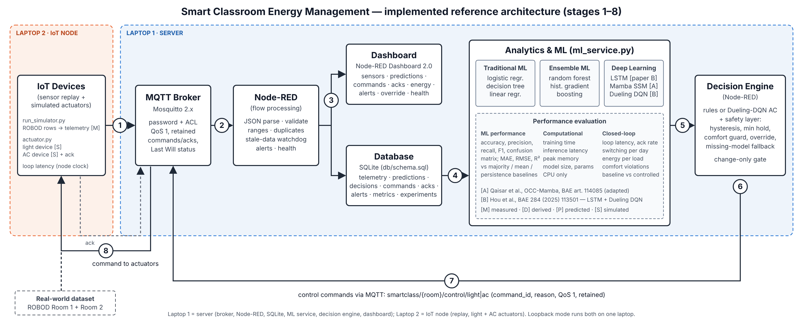

| Stage | Reference block | Implementation | Laptop |
|---|---|---|---|
| 1 | IoT devices / dataset | `run_simulator.py` (ROBOD rows + `sent_at_ms`); `actuator.py` (light + AC per room) | 2 |
| 2 | MQTT broker | Mosquitto 2.x: no anonymous access, password file, per-role ACL, QoS 1, retained commands/acks, Last Will | 1 |
| 3 | Node-RED processing | validation, duplicate drop, stale-data watchdog, alerts, device health | 1 |
| 4 | Database + dashboard | SQLite (`db/schema.sql`, 8 tables); Node-RED Dashboard 2.0 at `/dashboard` | 1 |
| 5 | Analytics & ML | `ml_service.py` / `smartclass/predictor.py`: 6 occupancy models, arrival profile, energy forecaster, DQN recommendation | 1 |
| 6 | Decision engine | Node-RED "Decision rules": rules or Dueling DQN behind a safety layer; change-only gate | 1 |
| 7 | Control via MQTT | `smartclass/{room}/control/{light,ac}` with `command_id`; `commands` table | 1 → 2 |
| 8 | Actuators + feedback | simulated state change; `smartclass/{room}/actuator/{load}` acknowledgement with `loop_latency_ms` | 2 → 1 |

**Single sources of truth.**

- The control logic exists once, in the Node-RED Decision rules node. Experiments and tests run that exact code
  through `tools/run_rules.js`.
- All thresholds live in the CONFIG node.
- The schema exists once, in `db/schema.sql`; a test checks that the Node-RED create-tables node matches it.

# 9. Hardware and software requirements

| Item | Laptop 1 (server) | Laptop 2 (node) |
|---|---|---|
| OS | Windows 10/11 (Linux/macOS scripts also provided) | Windows 10/11 |
| CPU / RAM / disk | any x86-64, 8 GB RAM, about 3 GB disk | 4 GB RAM, about 300 MB |
| Python | 3.11–3.13 (developed and tested on 3.13) | same |
| Node.js | 22 LTS (≥ 20.17); developed and tested on 22.23.4 | – |
| Mosquitto | 2.x (tested 2.0.18; team laptop 2.1.2) | – |
| Python packages (pinned) | numpy 2.2.6, pandas 2.2.3, paho-mqtt 2.1.0, scikit-learn 1.6.1, scipy 1.15.3, joblib 1.4.2, torch 2.14.1, psutil 7.1.3, matplotlib 3.10.7, pytest 8.4.2 | numpy, pandas, paho-mqtt only |
| Node packages (pinned) | node-red 4.1.17, @flowfuse/node-red-dashboard 1.34.0, node-red-node-sqlite 2.0.1 | – |
| Network | the same private LAN or hotspot; TCP 1883 and 1880 open on the Private profile, local subnet only | – |

Development and testing used a 2-vCPU Linux container (Intel Xeon, CPU only). No GPU is needed.

# 10. MQTT architecture

| Topic | Publisher → subscriber | QoS / retain | Payload (main fields) |
|---|---|---|---|
| `smartclass/{room}/telemetry` | node replay → Node-RED | 1 / no | room_id, timestamp (+08:00), sensors, energy [M], camera labels [M], `sent_at_ms` |
| `smartclass/{room}/validated` | Node-RED → ML service | 1 / no | the validated reading |
| `smartclass/{room}/analytics` | ML service → Node-RED | 1 / no | per-model probabilities [P], primary model, `p_arrival_30min`, energy forecast, `dqn_ac_action`, latency |
| `smartclass/{room}/control/{light,ac}` | Node-RED → actuator | 1 / **yes** | cmd, command_id, ts, reason, telemetry_sent_at_ms |
| `smartclass/{room}/actuator/{light,ac}` | actuator → Node-RED | 1 / **yes** | state, previous, accepted, command_id, loop_latency_ms |
| `smartclass/{room}/status`, `…/actuator_status`, `smartclass/ml_service/status` | each client | 1 / yes | online / offline (**Last Will**) |
| `smartclass/{room}/alert` | Node-RED | 1 / no | type, message |

**Security.** Anonymous access is disabled and passwords are stored as PBKDF2-SHA512 hashes. Two roles:

- `sc_server` can read and write `smartclass/#`;
- `sc_node` can only write telemetry, status and acknowledgements, and read control topics.

A node account therefore cannot command actuators. This is tested: the publish is dropped and the broker logs
`Denied PUBLISH`. Clients reconnect with 1–30 s exponential back-off. There is no TLS (LAN prototype, §29).

# 11. Node-RED flow

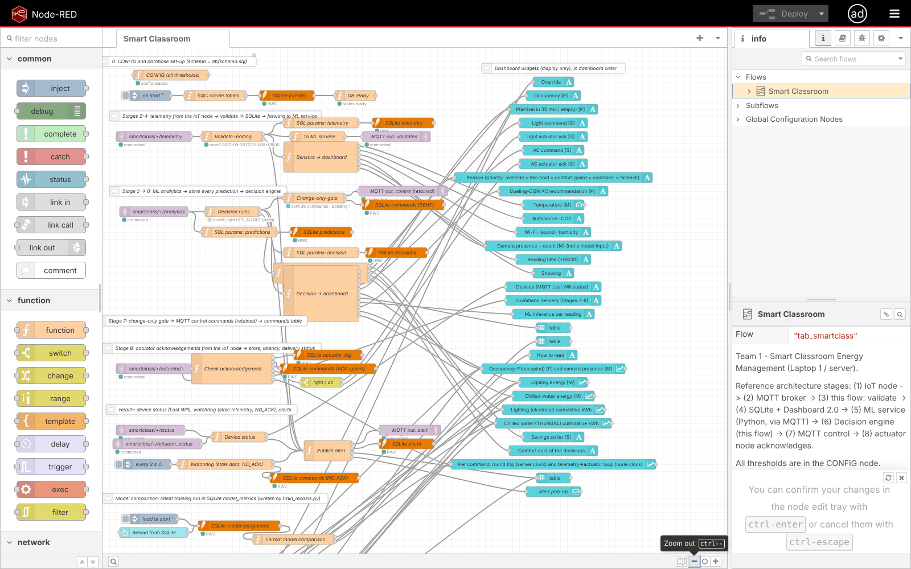

The flow (118 nodes, 22 function nodes) is laid out by stage:

0. CONFIG (all thresholds) and table creation from the schema.
1. Telemetry → **Validate reading** (JSON, allowed room, timestamp, ranges, required fields, duplicate drop) →
   SQLite → `validated`.
2. Analytics → predictions stored → **Decision rules** → decisions stored.
3. **Change-only gate**: a `command_id` is assigned, the command is published retained, and a SENT row is stored.
4. Acknowledgements → `actuator_log` and a command UPSERT (ACKED / REJECTED / ACKED_LATE), with round-trip and loop
   latency.
5. Device status (Last Will) and a watchdog every 2 s: stale telemetry after 15 s, NO_ACK after 5 s.
6. Model-performance and offline-experiment tables loaded from SQLite.

A catch node logs any node error.

**Editor security.** When `SC_EDITOR_PASSWORD` is set, the editor and admin API require a login (bcrypt hash at
start; unauthenticated requests get HTTP 401). Otherwise they only answer localhost. Broker credentials are written
from `.env` to the git-ignored `flows_cred.json` at every start.

# 12. Database design

| Table | Key columns | Purpose |
|---|---|---|
| `telemetry` | UNIQUE(room_id, ts) | every valid reading [M] |
| `predictions` | room, ts, model, probability, latency_ms | every model output [P] |
| `decisions` | room, ts, light, ac, reason, controller | every decision [S] |
| `commands` | command_id PK, status SENT / ACKED / REJECTED / NO_ACK / ACKED_LATE, roundtrip_ms, loop_latency_ms | delivery tracking |
| `actuator_log` | room, load, state, previous, accepted | every acknowledgement |
| `alerts` | ts, room, type, message | INVALID_READING, STALE_TELEMETRY, NO_ACK, LATE_ACK, DEVICE_OFFLINE, MODEL_UNAVAILABLE, … |
| `model_metrics` | run_id, task, model, split, metric, value | offline evaluation (imported from `models/training_report.json`) |
| `experiment_results` | run_id, experiment, scenario, metric, value, unit | registered experiments (imported from `results/*.csv`) |

`init_db.py` creates the schema and imports both registered result sets once per run id. It only reads the files and
never modifies them. Python writers use a 15 s busy timeout. A lock held longer than that raises a visible error
rather than dropping a row (tested).

# 13. Dashboard design

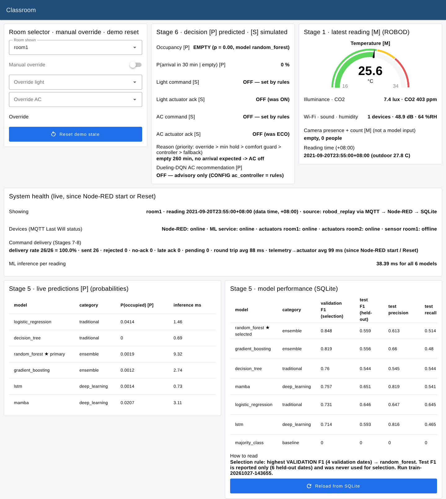

![Dashboard (2/3): occupancy [P] vs camera [M], recorded energy [M], baseline [M] vs controlled [S] cumulative energy](images/dashboard_charts.png)

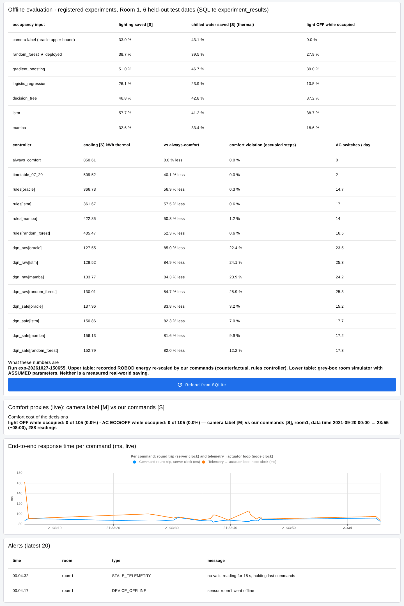

| Required panel | Implementation (group) | Data source |
|---|---|---|
| 1 Room selector | dropdown (Room selector · override · reset) | UI |
| 2 System health | "Showing" line, device status (Last Will), ML inference per reading | runtime + MQTT |
| 3 Latest sensor readings | Stage 1 group [M] | telemetry |
| 4 Temperature gauge | Stage 1 gauge, °C [M] | telemetry |
| 5 Occupancy prediction | Stage 6 text + occupancy chart: P(occupied) [P] vs camera [M], 0–1 | analytics |
| 6 Model prediction comparison | live predictions table, all 6 models [P], with ms | analytics |
| 7 Model performance comparison | table from SQLite `model_metrics`: validation F1 (selection), test F1/P/R, CV F1, latency; ★ selected | SQLite |
| 8 Inference latency | per-model ms + total per reading | analytics |
| 9 Lighting command | "Light command [S]: X — set by <layer>" | decision |
| 10 AC command | "AC command [S]: X — set by <layer>" + DQN recommendation line and priority | decision |
| 11 Actuator acknowledgement | light/AC actuator ack [S] | acknowledgements |
| 12 Cumulative lighting electrical energy | baseline [M] vs controlled [S], kWh | decision + reading |
| 13 Cumulative chilled-water thermal energy | baseline [M] vs controlled [S], kWh thermal | decision + reading |
| 14 Baseline vs controlled energy | the two charts above + per-reading recorded energy charts [M] | |
| 15 Energy savings where experimentally supported | live counterfactual % with data window; **registered offline results** table from SQLite `experiment_results` | SQLite |
| 16 Comfort violations | live: light OFF / AC ECO-OFF while camera says occupied; offline: wrong-OFF % per model and closed-loop violation % | runtime + SQLite |
| 17 Command delivery rate | `delivery rate N/N = x%`, sent, rejected, no-ack, late ack, pending | runtime |
| 18 End-to-end response time | chart per command: round trip (server clock) and loop (node clock), ms | acknowledgements |
| 19 Manual override | switch + light/AC selectors; shown as "set by manual override" | UI |
| 20 Reset/demo controls | Reset demo state; Reload from SQLite buttons | UI |

**Design rules.**

- Every title carries its unit, and [M]/[P]/[S] where values are shown.
- Live groups state their time range ("since Node-RED start or Reset", plus the data window in the text).
- Charts label their axis units.
- Empty data shows `n/a (…)` or an instruction such as "run python init_db.py", never a misleading 0%.

**Change from v3.** The model-comparison panel used to be empty on a fresh database. Its data now comes from SQLite,
and a test feeds real rows to the formatter. The AC panel used to show "BOOST (rules, DQN says OFF)". It now states
which layer decided and the DQN status (§19).

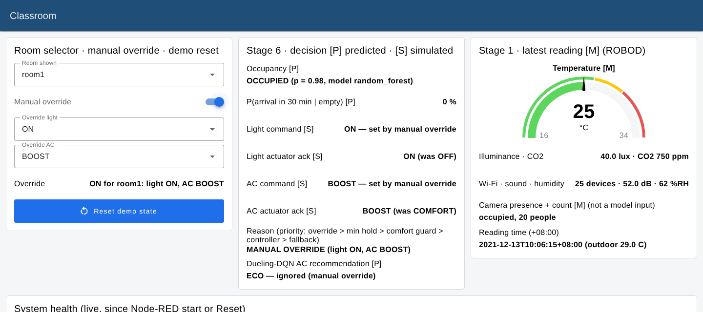

# 14. Feature engineering

- **Sensors** (time t): Wi-Fi devices, CO₂, sound, humidity, temperature, illuminance.
- **Time:** sine/cosine of the time of day, and weekday.
- **Tabular extras:** Wi-Fi 30-minute mean, CO₂ change over 15 and 55 minutes, 30-minute maximum sound, 15-minute
  temperature change.
- **Sequences:** the last 12 readings (1 hour) of the 9 sensor and time features.

**Leakage controls** (all tested):

- every feature uses only time ≤ t;
- whole-date splits;
- scalers fitted on training dates only;
- camera labels are never inputs;
- the live feature computation equals the offline one.

An ablation on training and validation dates only showed that the extra sensors help (random forest F1 0.733 vs
0.630).

# 15. Traditional ML

| Model | Settings |
|---|---|
| majority class | baseline |
| logistic regression | standardised, class-balanced |
| decision tree | depth 5, class-balanced |
| linear regression (energy) | next-5-minute lighting and chilled water |

# 16. Ensemble ML

| Model | Settings |
|---|---|
| random forest | 200 trees, min leaf 5, class-balanced, seed 42 |
| histogram gradient boosting | 200 iterations, learning rate 0.05, seed 42 |
| random forest / gradient boosting regressors | energy forecasting |

# 17. Deep learning

**LSTM (paper B):** one LSTM layer of 32 units, with the last hidden state passed to a logit (5,537 parameters).
Trained with Adam (1e-3), class-weighted BCE and early stopping on validation F1.

**Mamba (paper A adaptation):** 17,217 parameters, pure PyTorch, no CUDA kernel.

- A linear embedding to d = 32, then two pre-norm residual Mamba blocks.
- Each block: expand 2, causal depth-wise convolution (kernel 4), SiLU, input-dependent Δ/B/C (state 8),
  zero-order-hold discretisation, a selective scan, a D skip connection and SiLU(z) gating.
- RMSNorm, then the last time step goes to a logit.

# 18. Research-paper adaptations

| Aspect | Paper | Ours | Why |
|---|---|---|---|
| A: architecture | OCC-Mamba (configuration not accessible) | generic Mamba blocks (Gu & Dao) | full text unavailable; we claim only the model family |
| B: occupancy labels | CO₂ change-point labels | ROBOD camera labels | ground truth exists |
| B: LSTM inputs | CO₂ | 6 sensors + time (CO₂ included) | richer signals available |
| B: DRL state/action/reward | not accessible | ours (§20) | declared openly |
| B: plant | their simulation platform | grey-box RC thermal + CO₂ model with assumed parameters | ROBOD cannot identify the plant (R² ≤ 0.044) |
| B: deployment | – | DQN behind a safety layer; rules remain the default | comfort results (§25) |

Neither paper is reproduced exactly. Both are *research-inspired adaptations*.

# 19. Decision engine

**Priority order** (highest first), recorded per decision as `light_source` / `ac_source`:

1. manual override;
2. minimum-hold time;
3. comfort safety guard;
4. selected AC controller (`ac_controller` = `rules` (default) or `dqn`);
5. missing-model fallback.

**Rules:**

- **Hysteresis:** occupied at p ≥ 0.25, empty only at p < 0.15. These values were tuned on the validation dates:
  the most comfort-protective pair with ≥ 30% lighting saving. The earlier 0.6/0.4 switched off 22.5% of occupied
  validation intervals; 0.25/0.15 switch off 13.7%.
- **Occupied:** light ON (DIM above 300 lux, Room 2 only), AC COMFORT, or BOOST above comfort + 1.5 °C.
- **Empty:** a 15-minute grace period, then light OFF and AC ECO; AC OFF after 30 minutes if no arrival is expected.
- **PRECOOL:** when P(arrival within 30 min) ≥ 0.2 and the room is more than 0.5 °C above comfort.
- **Minimum hold:** 10 minutes for downward switches; switching up for an occupied room is immediate.
- **Start-up:** never switches an empty room ON.
- **No model output:** hold the last commands, else the 08–20 timetable.
- **Change-only gate:** `command_id` = room/load/data time/server ms-sequence. The sequence suffix was added in v4
  after a test exposed a same-millisecond collision.

**The "AC BOOST while DQN says OFF" discrepancy.** In the default rules mode the DQN is advisory only. The rules
chose BOOST because the room was occupied above 25.5 °C. The dashboard now shows "BOOST — set by rules" and "DQN:
OFF — advisory only (CONFIG ac_controller = rules)". In DQN mode it shows, for example, "COMFORT — set by comfort
safety guard" and "overridden by comfort guard (DQN wanted OFF)". The safety layer is never bypassed in favour of
the DQN. `test_displayed_ac_source_matches_the_decision` checks every case.

# 20. Dueling DQN

- **Network:** Q(s,a) = V(s) + A(s,a) − mean A, with 2×64 ReLU layers; 24 kB on disk; 0.12 ms per decision.
- **State:** LSTM P(occupied), P(arrival), temperature, CO₂, outdoor temperature, time of day.
- **Actions:** OFF / ECO / COMFORT / BOOST.
- **Reward per 5 minutes:** −(cooling kWh / COP 3.5 + fan kWh) − 0.5 × K outside 23–26 °C − 0.3 × (CO₂ − 1000)/100.
  The last two terms apply only while occupied.
- **Training:** replay buffer 50k, target sync every 1,000 steps, ε 1 → 0.05, γ 0.97, Huber loss, 400 one-day
  episodes on training + validation dates (219 s on CPU). The occupancy input is **out-of-fold** LSTM probabilities,
  to avoid in-sample optimism.

**Simulator.** A first-order RC model with an ideal thermostat per mode (ECO 26, COMFORT 24, BOOST 23 °C) and a CO₂
mass balance, driven by ROBOD's outdoor temperature, solar radiation, outdoor CO₂ and occupant counts. The parameters
are assumed and declared (`smartclass/room_env.py`; copied to `models/training_report.json` → `dqn.simulator`). They were calibrated so the
free-running room peaks around 30 °C and 24/7 COMFORT uses about 140 kWh thermal per day (ROBOD median 132).

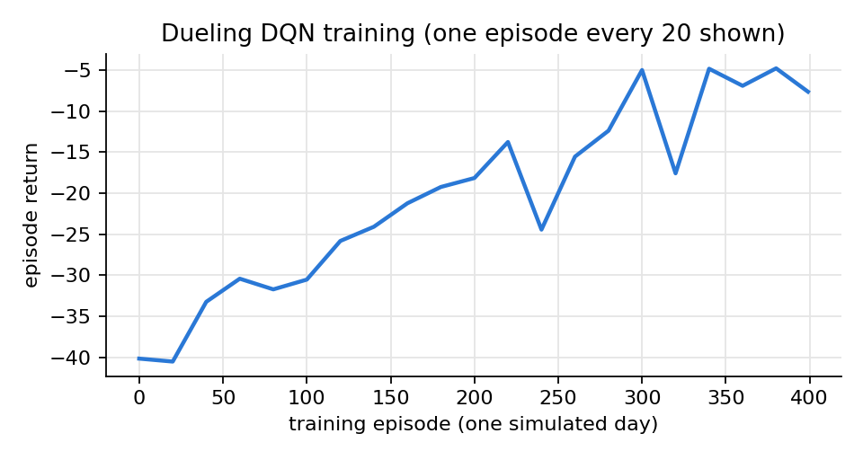

# 21. Actuator simulation

`actuator.py` runs on Laptop 2, one process per room, controlling two loads:

- light: ON / DIM / OFF;
- AC: OFF / ECO / COMFORT / BOOST / PRECOOL.

For each command it validates the value, applies it to the simulated state, and publishes a retained
acknowledgement containing the state, previous state, `accepted`, `command_id` and `loop_latency_ms` (from the
reading's `sent_at_ms`, on the node clock). An unknown command is rejected and raises `ACTUATOR_REJECTED`. Nothing
physical is switched: **no physical actuator was tested**.

# 22. Experimental methodology

| Experiment | Protocol | Output |
|---|---|---|
| Occupancy models | train on 19 dates; select / tune on 4 validation dates; report on 6 test dates; 5-fold GroupKFold by date on train + validation; Room 2 cross-room | `results/model_comparison.csv` |
| Test-set uncertainty (v4, supplementary) | the saved models re-predict the test dates (F1 reproduced exactly), then a 2,000× date-cluster bootstrap (seed 42) with a paired difference vs the primary | `results/supplementary/bootstrap_ci_*.csv` |
| Energy forecasting | next 5 minutes, test dates, vs mean and persistence baselines | `results/energy_comparison.csv` |
| Recorded counterfactual | recorded energy × our command (light OFF 0, DIM 0.5; AC OFF 0, ECO 0.75) per occupancy source; sensitivity ECO 0.5–0.9, DIM 0.3–0.7 | `results/savings_results.csv`, `savings_comfort.csv` |
| Closed-loop simulation | 6 test days in the grey-box room; always-on, timetable, rules, raw DQN, DQN + safety; occupancy from camera / LSTM / Mamba / RF | `results/closed_loop_results.csv` |
| DQN reward weight (v4, supplementary) | 150 episodes, camera occupancy, raw policy, 6 test dates; one row per run | `results/supplementary/dqn_reward_sweep.csv` |
| Live closed loop | a full-day replay through MQTT / Node-RED / ML / actuators; metrics from SQLite | `results/live_closed_loop_report.json`, `EVIDENCE/energy_results/live_run_v4_report.json` |

**Integrity rules followed.**

- Test dates were never used for training, selection or tuning.
- Registered results (`results/*.csv`, `models/training_report.json`, run `train-20261027-143655` /
  `exp-20261027-150655`) were not modified in v4.
- New analyses write new files.

All seeds are 42. A from-scratch retrain reproduced the registered metrics (v3).

# 23. Model evaluation

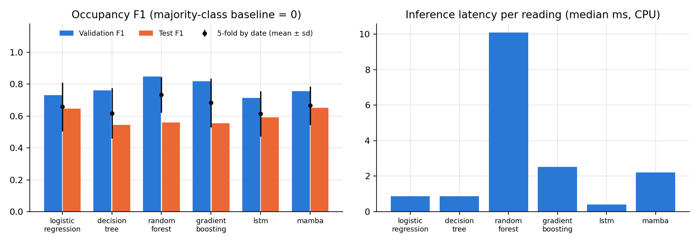

| Model | Category | Val F1 | Test acc. | Test P / R | **Test F1** [95% CI] | CV F1 (5 folds) | Room 2 F1 | Train (s) | Latency median / p95 (ms) | Size (kB) |
|---|---|---|---|---|---|---|---|---|---|---|
| majority class | baseline | 0.000 | 0.800 | 0 / 0 | 0.000 | 0.00 | 0.000 | 0.0 | 0.02 / 0.03 | 1 |
| logistic regression | traditional | 0.731 | 0.859 | 0.65 / 0.65 | 0.646 [0.34, 0.77] | 0.66 ± 0.15 | 0.679 | 0.02 | 0.88 / 1.41 | 2 |
| decision tree | traditional | 0.760 | 0.818 | 0.55 / 0.54 | 0.544 [0.20, 0.77] | 0.62 ± 0.16 | 0.657 | 0.04 | 0.86 / 1.02 | 6 |
| **random forest ★** | ensemble | **0.848** | 0.838 | 0.61 / 0.51 | 0.559 [0.19, 0.78] | **0.73 ± 0.11** | 0.667 | 1.0 | 10.1 / 14.5 | 4,235 |
| gradient boosting | ensemble | 0.819 | 0.846 | 0.66 / 0.48 | 0.556 [0.14, 0.77] | 0.68 ± 0.15 | 0.635 | 0.7 | 2.5 / 3.6 | 729 |
| LSTM (B) | deep | 0.714 | 0.872 | 0.82 / 0.47 | 0.593 [0.06, 0.81] | 0.61 ± 0.14 | 0.637 | 4.9 | 0.40 / 0.54 | 26 |
| Mamba (A) | deep | 0.757 | **0.884** | 0.82 / 0.54 | **0.651** [0.30, 0.78] | 0.67 ± 0.12 | 0.570 | 24.9 | 2.2 / 3.0 | 77 |

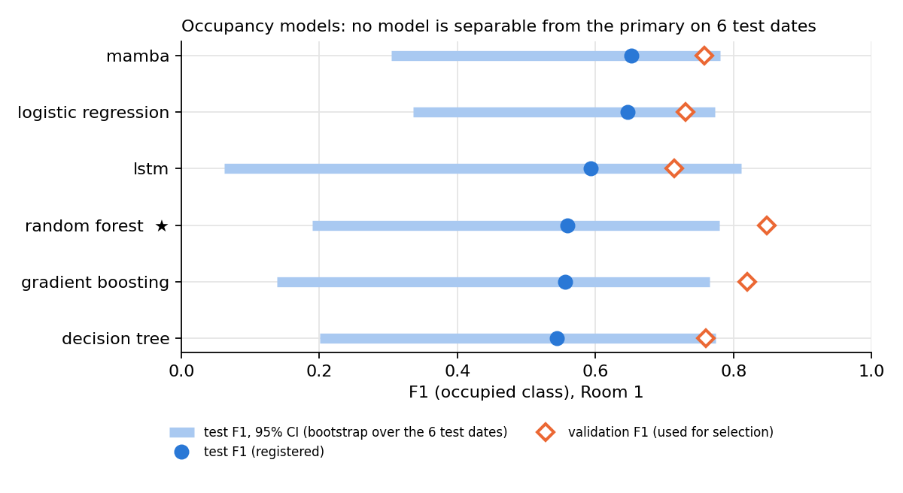

**Why the random forest is primary.**

- It was selected by the pre-registered rule: the highest **validation** F1 (0.848). It also had the best CV F1.
- Mamba scores higher on test (0.651 vs 0.559), but re-selecting by test F1 would be test-set selection and is not
  done.
- The paired bootstrap shows the gap is not significant: Mamba − RF = +0.093 [−0.18, +0.38]; LR − RF = +0.091
  [−0.23, +0.45]; all CIs include 0.
- The per-date F1 explains the width. Two test days have 0 and 1 occupied intervals, so F1 there is 0 for every
  model. On the other four days, per-model F1 ranges from 0.00 to 0.88 (`bootstrap_ci_test_f1.csv`).

**Conclusion.** All models are far above the baseline. The deep models are the most precise but miss about half of
the occupied intervals. Model differences are within the date-to-date variance. Every model runs in ≤ 15 ms per
reading (p95) on one CPU thread.

**Energy forecasting (next 5 minutes, test dates):**

| Model | Lighting MAE (kWh) | Lighting R² | Chilled-water MAE (kWh th) | Chilled-water R² |
|---|---|---|---|---|
| mean baseline | 0.0539 | −0.00 | 0.669 | −0.02 |
| persistence | **0.0022** | 0.965 | 0.450 | −0.09 |
| linear regression | 0.0028 | **0.966** | 0.466 | 0.32 |
| random forest | 0.0144 | 0.836 | 0.244 | 0.66 |
| gradient boosting | 0.0040 | **0.966** | **0.243** | **0.70** |

**Pre-cooling arrival profile (test dates):** 7 of 47 arrivals caught, 158 false alarms (F1 0.066). Weak, and
reported as such.

# 24. Energy evaluation

All numbers in this section are **simulated**. None is a measured saving in a real building.

**Recorded-energy counterfactual** (Room 1, 6 test dates, rules; ECO 0.75, DIM 0.5):

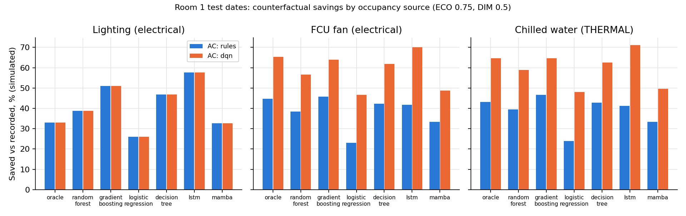

| Occupancy input | Lighting saved | Chilled water saved (thermal) | FCU fan saved | Lights OFF while occupied |
|---|---|---|---|---|
| camera label (upper bound) | 33.0% | 43.1% | 44.7% | 0 / 344 |
| **random forest (deployed)** | 38.7% | 39.5% | 38.4% | 96 / 344 (27.9%) |
| logistic regression | 26.1% | 23.9% | 23.0% | 36 / 344 (10.5%) |
| Mamba | 32.6% | 33.4% | 33.3% | 64 / 344 (18.6%) |
| LSTM | 57.7% | 41.2% | 41.8% | 133 / 344 (38.7%) |

Savings above the camera bound come from switching off occupied rooms: they are a comfort cost, not a real saving.
Chilled-water savings move by less than 1.5 points across ECO 0.5–0.9, because most of the saving comes from AC OFF.

**Closed-loop simulation** (6 test days, AC only):

| Controller | Cooling kWh_th | vs always-on | Fan kWh_e | Outside 23–26 °C (occupied) | K·h | AC switches/day |
|---|---|---|---|---|---|---|
| always COMFORT | 850.6 | – | 37.5 | 0.0% | 0.00 | 0.0 |
| timetable 07–20 | 509.5 | −40.1% | 20.3 | 0.0% | 0.00 | 2.0 |
| rules + camera (bound) | 366.7 | −56.9% | 12.3 | 0.3% | 0.01 | 14.7 |
| rules + LSTM | 361.7 | −57.5% | 12.3 | 0.6% | 0.07 | 17.0 |
| rules + Mamba | 422.9 | −50.3% | 15.1 | 1.2% | 0.08 | 14.0 |
| **rules + random forest (default)** | **405.5** | **−52.3%** | 14.2 | **0.6%** | 0.07 | 16.5 |
| DQN raw + LSTM (paper B pairing) | 128.5 | −84.9% | 2.3 | 24.1% | 3.13 | 25.3 |
| DQN + safety + LSTM | 150.9 | −82.3% | 2.8 | 7.0% | 0.59 | 17.7 |
| DQN + safety + random forest | 152.8 | −82.0% | 2.7 | 12.2% | 1.20 | 17.3 |

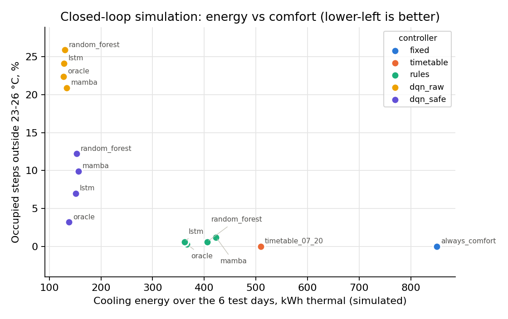

# 25. Comfort analysis

- **Rules:** 0.6% of occupied intervals outside 23–26 °C with the deployed model, close to the 0.3% camera bound.
  The mean occupied temperature is about 24 °C. CO₂ never exceeded 1,000 ppm in any scenario, so the IAQ term was
  never binding.
- **Lighting** is the real comfort weakness of predicted occupancy: wrong OFF in 27.9% of occupied intervals on the
  test dates with the deployed model; 13.7% on validation; 8.1% on Room 2. A deployment needs a motion sensor or a
  minimum-lighting fallback.
- **DQN:** the raw policy leaves occupied rooms warm (mean about 25.7 °C, 24.1% violations). The safety layer cuts
  this to 7.0%. Raising the comfort weight 0.5 → 2.0 (shortened protocol, `dqn_reward_sweep.csv`) cut violations
  26.5% → 1.7% for +5% cooling (115.7 → 121.6 kWh thermal). So the problem is the reward weighting, which should be
  tuned on validation dates in future work.
- **Live comfort panel:** during the 2021-09-20 replay, 0 of 105 occupied readings had the lights OFF or the AC
  ECO/OFF.

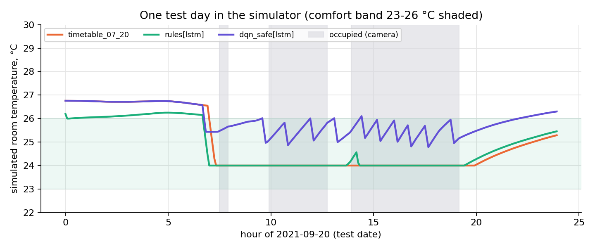

# 26. Performance evaluation

**Live run, v4** (one machine through its network interface; `EVIDENCE/energy_results/live_run_v4_report.json`):

- 290 readings (288 replay + 2 demo test messages), 290 decisions, 6 × 290 predictions;
- 29 commands, 100% acknowledged;
- round trip: median 88 ms, p95 92, max 93;
- telemetry → actuator loop: median 94 ms, p95 159, max 162;
- per-model inference: 1.0–12.7 ms;
- 38–54 ms for all six models per reading.

**v3 registered run** (518 readings, 46 commands): 100% acknowledged; round trip median 88 ms; loop median 96 ms
(p95 153).

The end-to-end test repeats the loop with 60 readings and asserts 100% acknowledgement and loop latency < 5 s.
Two-laptop Wi-Fi latency is **not yet measured** (checklist 6.10).

# 27. Testing

`python -m pytest -q`: **97 passed, 1 skipped** (the opt-in end-to-end test). `SC_E2E=1 pytest
tests/test_e2e_loopback.py`: **1 passed**. Logs and details are in `FINAL_DELIVERY/TEST_RESULTS/`.

| File | Tests | Covers |
|---|---|---|
| test_data_features | 9 | schema/size, units and kinds, timestamps, no silent filling, date splits, no future information, live = offline features, windows |
| test_models_eval | 7 | every category trains/predicts, save/load, seeded deep training, dueling head + environment, report consistency, live predictor + fallback |
| test_messages_actuator | 4 | payloads, actuator accept/reject |
| test_flow_functions | 19 | validation, duplicates, stale data, gate ids, ACK, savings n/a, comfort counters, SQLite-driven model and experiment panels |
| test_rules | 14 | hysteresis, grace, AC off, BOOST, pre-cool, hold, start-up, override, DQN + safety, **displayed ac_source** |
| test_config_flows | 13 | flow wiring, topics, dashboard widgets, schema = flow, no secrets in flows, pinned packages, broker not anonymous + ACL, .env handling |
| test_failures | 19 | broker down, wrong credentials, ACL, broker restart + reconnect, ML crash (Last Will), missing model / DQN / sensor, DB locked, late / unknown / bad ACK, credential generation, dataset tampering |
| test_scripts | 12 | setup/start/stop scripts per role, `bash -n`, the PowerShell parser on every `.ps1`, PowerShell helpers, firewall scope |
| test_e2e_loopback (opt-in) | 1 | real broker + Node-RED + ML + actuator + replay |

**Bugs found by testing in v4:**

- command-id collision within one millisecond (fixed with a sequence suffix);
- late acknowledgements after NO_ACK were silently ignored (now ACKED_LATE + alert);
- the stop script returned before Node-RED had exited, so a quick restart hit the port check (it now waits);
- Node-RED's `.sessions.json` was tracked by git (now ignored).

# 28. Two-laptop deployment

Laptop 1 runs `setup_server.ps1` → `open_firewall.ps1` (Administrator, once) → `start_server.ps1`. Laptop 2 runs
`setup_node.ps1 -ServerIp <IP>` → `start_node.ps1`. Shutdown is `stop_node.ps1` / `stop_server.ps1`.

The scripts:

- detect Python, Node.js and Mosquitto;
- install the dependencies;
- generate credentials with `secrets` (`tools/init_env.py`);
- validate `.env` (no placeholders) and the dataset hash;
- refuse to start on a busy 1883 or 1880 port, naming the owning process;
- print the LAN IP;
- test TCP and MQTT login from the node;
- record PIDs for the stop scripts.

The full procedure, expected outputs and a 15-item two-machine checklist are in `docs/TWO_LAPTOP_DEPLOYMENT_GUIDE.md`.

**Verification status:**

- PowerShell scripts: parse-checked with PowerShell 7.4, helpers executed — AUTOMATED TEST PASSED.
- Windows-only cmdlets: NOT VERIFIED.
- The Linux scripts ran the complete system — MANUALLY VERIFIED.
- Two physical laptops: **NOT VERIFIED (pending)**.

# 29. Limitations

1. **Small data:** 29 dates, of which 6 are test dates (two nearly empty). Model rankings are not statistically
   separable (§23).
2. **OCC-Mamba** is followed only at the model-family level, because the full text was not accessible.
3. **Grey-box plant** with assumed parameters: absolute closed-loop energy is indicative only.
4. **Counterfactual energy** assumes energy scales with our command. It cannot add energy when we would switch
   something on, and pre-cooling energy is not added, so savings are optimistic.
5. **Lighting comfort:** wrong OFF in 8–28% of occupied intervals, depending on room and split.
6. **DQN:** the comfort weight is too low and switching is frequent (14–25 per day for all adaptive controllers).
7. **Security:** no TLS on MQTT; the dashboard (including override and reset) has no login on the LAN; the
   editor has a single shared admin account.
8. **Not verified:** two physical laptops; Windows-only cmdlets; macOS; Python 3.11/3.12; physical actuators; the
   dataset licence.

# 30. Future work

- A PIR motion sensor or minimum-lighting fallback to remove wrong lights-OFF.
- Tune the DQN reward (comfort weight, switching penalty, previous action in the state) on validation dates.
- More dates and rooms for stable model selection; report CIs as standard.
- TLS for MQTT, plus a dashboard login for the override controls.
- Obtain the OCC-Mamba full text to align the architecture.
- A pilot in a real room with metered energy and relays, and a measured before/after comparison.

# 31. Conclusion

The system implements all eight reference stages with authenticated MQTT, Node-RED integration, SQLite, a Node-RED
dashboard that reads its evaluation results from the database, and a complete command and acknowledgement loop.
Delivery is measured: 100% acknowledged, with a round trip of about 0.09 s on one machine.

Traditional, ensemble and deep models, including the two research adaptations, were compared on held-out dates
without test-set selection. Mamba scored highest on test, but the differences are within the date-to-date
uncertainty, and the validation-selected random forest remains primary.

Occupancy-driven rules halved simulated cooling energy at under 1% comfort violations. The paper-B Dueling DQN saves
more but needs a stronger comfort weight, so it stays optional behind a safety layer.

Every number in this report is traceable to a result file, and every saving is a simulation result. Two-laptop
operation is prepared and scripted; its physical verification is the team's remaining step.

# 32. References

1. Z. D. Tekler, Y. Lei, Y. Peng, C. Miller, A. Chong. ROBOD, room-level occupancy and building operation dataset.
   *Building Simulation* 15(12), 2022. https://doi.org/10.1007/s12273-022-0925-9 · data:
   https://github.com/ideas-lab-nus/robod
2. I. Qaisar, K. Sun, D. Zhong, X. Yang, X. Miao, Q. Zhao. OCC-Mamba: A Mamba-based deep learning approach for indoor
   occupancy prediction. *Building and Environment*, article 114085. https://doi.org/10.1016/j.buildenv.2025.114085
   (record verified; full text not accessed).
3. F. Hou, J. C. P. Cheng, J. Ma, H. H. L. Kwok, C. Huang, Z. Wu. Occupancy-driven HVAC control optimization via LSTM
   and deep reinforcement learning for enhanced indoor air quality, thermal comfort and energy efficiency. *Building
   and Environment* 284 (2025) 113501. https://doi.org/10.1016/j.buildenv.2025.113501
4. A. Gu, T. Dao. Mamba: Linear-Time Sequence Modeling with Selective State Spaces. arXiv:2312.00752 (v2, 2024).
5. Z. Wang, T. Schaul, M. Hessel, H. van Hasselt, M. Lanctot, N. de Freitas. Dueling Network Architectures for Deep
   Reinforcement Learning. *ICML* 2016, arXiv:1511.06581.
6. K. Sun, I. Qaisar, M. A. Khan, T. Xing, Q. Zhao. Building occupancy number prediction: A Transformer approach.
   *Building and Environment* 244 (2023) 110807.
7. OASIS. MQTT Version 3.1.1 (2014). Eclipse Mosquitto documentation (mosquitto.conf, ACL). Node-RED 4 and FlowFuse
   Dashboard 2.0 documentation.

# 33. Team contributions

The decision engine, Dueling DQN and energy evaluation is the largest ML-algorithm part of the project, and was
shared by two members.

| Member | Roll number | Subsystem | Main files |
|---|---|---|---|
| NIRANJAN N S | AM.SC.U4CSE23338 | Decision engine, Dueling DQN, energy and comfort evaluation (shared with Sivadev Smijith) | Decision rules / CONFIG, `smartclass/dqn.py`, `room_env.py`, `run_experiments.py` |
| SIVADEV SMIJITH | AM.SC.U4CSE23359 | Decision engine, Dueling DQN, energy and comfort evaluation (shared with Niranjan N S); Node-RED integration, SQLite, dashboard | as above; `nodered/flows.json`, `settings.js`, `db/schema.sql`, `init_db.py` |
| YALAMARTHI JYOTHI SRI KRISHNA CHAITANYA | AM.SC.U4CSE23370 | IoT node, MQTT broker, security, two-laptop deployment | `run_simulator.py`, `actuator.py`, `config/mosquitto/`, `scripts/`, `tools/init_env.py` |
| PENUMALLU RAM DINESH REDDY | AM.SC.U4CSE23341 | Dataset, features, traditional and ensemble ML, evaluation | `smartclass/dataset.py`, `features.py`, `train_models.py`, `tools/bootstrap_ci.py` |
| MANISH SHISHIRCHANDRA DORA ALURI | AM.SC.U4CSE23333 | Deep learning and research adaptations (LSTM, Mamba), ML service | `smartclass/deep_models.py`, `ml_service.py`, `predictor.py` |

# 34. Reproduction instructions

```bash
# Laptop 1 (Linux/macOS; Windows: the .ps1 equivalents in docs/TWO_LAPTOP_DEPLOYMENT_GUIDE.md)
bash scripts/setup_server.sh               # venv, deps, .env with random passwords, dataset + SHA-256, models, npm, broker users, DB
.venv/bin/python download_data.py --verify # PASS x2: sha256 matches, 8352 rows, schema ok
.venv/bin/python train_models.py           # ~10 min CPU; writes models/ and results/model_comparison.csv (seed 42)
.venv/bin/python run_experiments.py        # counterfactual + closed loop; results/*.csv and figures
.venv/bin/python tools/bootstrap_ci.py     # supplementary CIs (re-predicts with saved models; checks registered F1)
.venv/bin/python tools/dqn_reward_experiment.py --comfort-per-k 2.0   # supplementary reward-weight run
.venv/bin/python -m pytest -q              # 97 passed, 1 skipped
SC_E2E=1 .venv/bin/python -m pytest -q tests/test_e2e_loopback.py      # 1 passed
bash scripts/start_server.sh               # then on the node: bash scripts/start_node.sh --date 2021-09-20
```

**Versions and configuration:**

- Python 3.13.17, Node.js 22.23.4, Mosquitto 2.0.18, node-red 4.1.17; Python pins in `requirements*.txt`.
- Seeds 42 everywhere.
- Splits and features in `models/training_report.json`; model manifest in `models/final/manifest.json`.
- Thresholds in the Node-RED CONFIG node; simulator parameters in `smartclass/room_env.py` and the training report.
- Re-running `train_models.py` / `run_experiments.py` creates **new** run ids and overwrites `results/`. To keep the
  registered results, work on a copy, or compare against the ZIP.
